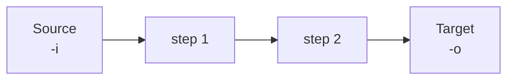
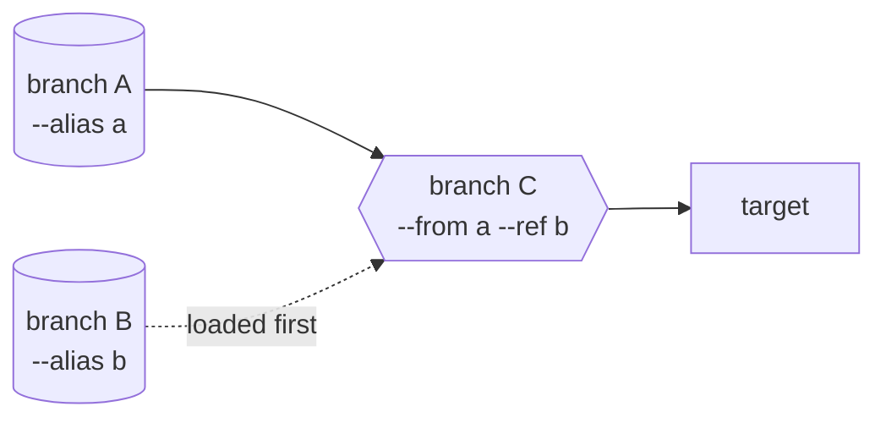

# Concepts

[← Documentation](README.md)

## A pipeline: a source, steps, a target



Rows are read from the source, pass through the steps in the order you wrote them, and are written
to the target. Nothing is staged in between. `dtpipe -i people.csv -o people.parquet` is a whole
pipeline, with no step.

A run starts, streams and exits. There is no daemon and no scheduler: `cron` or a CI job decides
when it runs.

| Term | Meaning |
|:---|:---|
| **Provider** | A reader or a writer for one system: `pg`, `csv`, `s3`… `dtpipe providers` lists them |
| **Step** | A transformer: `--fake`, `--mask`, `--compute`, `--filter`… Consecutive flags of the same kind form one step |
| **Branch** | One source-to-target path. A command line with one `-i` has one branch |
| **Alias** | The name of a branch, given with `--alias`, so another branch can read it |
| **Job** | A pipeline written as a YAML file, run with `--job` |

## Several branches make a DAG

One command line can hold several branches. They run at the same time, in one process, and pass
rows to each other in memory.



- `--from a` reads branch `a` as it streams. Use it for the large input.
- `--ref b` loads branch `b` in full first. Use it for a lookup table.
- A branch with no `-o` publishes its rows under its alias; a branch with an `-o` publishes nothing.

Joins, merges and fan-outs are built from these: see [DAG pipelines](guides/dag.md).

## Order matters, and repetition means something

Steps run in the order written, and every run prints the chain it built:

```
--fake "name:name.fullName" --fake "email:internet.email" --mask "phone:######****"
→  fake → mask
```

Repeating `-i` or `--from` opens a **new branch**. Any other flag is given once in its stage, and a
branch flag such as `--alias` once in its branch, so a list is comma-separated:

```bash
--ref a,b        # ✓ one branch reading two lookups
--ref a --ref b  # ✗ refused
```

Reader options go before the branch's alias, writer options after `-o`. The full rules are in
[REFERENCE.md](../REFERENCE.md#dag-syntax).

## Row mode and Arrow mode

Every run prints how the rows travelled:

| Marker | Meaning |
|:---|:---|
| `● row` | Row by row: database drivers and JavaScript steps work this way |
| `◈ Arrow` | In columnar batches: Parquet, DuckDB and `--sql` work this way |

dtpipe converts between the two when a pipeline mixes them, and `--dry-run` names each conversion.
This is why `--sql` is usually faster than `--compute`: see
[SQL and JavaScript](guides/sql-and-javascript.md).

Rows travel in batches of 32 768 (`--batch-size`), so memory stays flat whatever the volume. Work
that must see every row at once, such as a sort or a deduplication, belongs in `--sql`.

## Three ways to run the same pipeline

| Form | For |
|:---|:---|
| Command line | Interactive work and shell pipes (`csv:-` reads stdin, `jsonl:-` writes stdout) |
| YAML job (`--job`) | Anything you run again: review it, version it, run it from CI. See [Jobs and production](guides/production.md) |
| MCP server or agent | An AI assistant. See [The agent](guides/agent.md) |

All three run the same engine with the same behaviour.

## Exit codes

| Code | Meaning |
|:---|:---|
| `0` | Success |
| `1` | Failure. The message names what failed and, when there is one, the fix |
| `130` | Cancelled (Ctrl-C). In a multi-branch run, one cancelled branch cancels the run |

A cancelled run never reports success.

---

Next: [Connection catalog](connections/README.md) · [DAG pipelines](guides/dag.md) ·
[REFERENCE.md](../REFERENCE.md)
