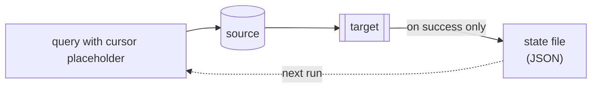

# Incremental loading

[← Documentation](../README.md)

Transfer only what changed. dtpipe tracks the highest value it saw in a column, writes it to a
state file after a **successful** run, and lets the next run read it back into the query.



## Two flags that track, one resolver that filters

The split matters more than the count: the flags record the mark, and **nothing filters until the
resolver is in the query**. A run carrying only the two flags reads its whole source every time
and says so — see the warning below.

| Piece | Role |
|:---|:---|
| `--cursor COLUMN` | The column to watch. Name it **as the reader returns it** — upper case for an unquoted Oracle identifier |
| `--state PATH` | Where the mark is persisted. There is **no default path** |
| `${{cursor://PATH\|DEFAULT}}` | **In the query** — this is what filters. `PATH` is the same file `--state` names; `DEFAULT` is what the first run uses, before any state file exists |
| `--cursor-from VALUE` | Optional. Ignore the state file for this run and start from here — for a backfill or a replay |

> [!IMPORTANT]
> **The two flags go together, and the resolver goes with both.** `--cursor` without `--state`
> is refused before anything runs, and so is the reverse. The pair **without** the resolver is
> accepted and warns — *« sets 'cursor: …', but no `${{cursor://…}}` appears »* — because it
> tracks correctly and filters nothing: every run re-reads the whole source, and the mark it saves
> is never read back.

The path inside the resolver is the same file `--state` names — **write it twice**, or the query
reads a mark nothing updates and the run silently re-reads everything.

```bash
dtpipe -i "pg:Host=prod;Database=app;Username=app" \
  --query "SELECT * FROM orders
           WHERE updated_at > '${{cursor://state/orders.json|1970-01-01T00:00:00.000}}'" \
  -o "sqlite:Data Source=dw.db" --table orders --strategy Append \
  --cursor updated_at --state state/orders.json
```

## The state file

Plain JSON — readable, diffable, and safe to commit or to keep in a mounted volume:

```json
{
  "version": 1,
  "cursor": { "column": "updated_at", "value": "2026-06-15T23:59:59.000", "type": "datetime" },
  "last_run": {
    "started_at": "2026-06-16T02:00:00Z",
    "completed_at": "2026-06-16T02:03:42Z",
    "rows_transferred": 1234,
    "status": "success"
  }
}
```

The mark advances only on success, so a failed run re-reads the same window rather than skipping
it.

## Things that bite

**Strict `>` versus `>=`.** With `>`, a row whose timestamp equals the mark is never picked up
again — losing rows written in the same instant as the last one read. With `>=`, the boundary rows
are re-read and re-written each run, which is only safe with `--strategy Upsert`. Pick the pair
deliberately: `>` + `Append`, or `>=` + `Upsert`.

**Oracle needs a format mask.** A `TIMESTAMP` compared against a bare literal is parsed with the
session's `NLS_TIMESTAMP_FORMAT`, which is not the format the state file writes. Wrap it in
`TO_TIMESTAMP(…, 'YYYY-MM-DD"T"HH24:MI:SS.FF3')` — see [Oracle](../connections/oracle.md).

**One writer, one state file.** Two branches writing the same state file would corrupt each
other's cursor, so the DAG validator refuses it before anything runs.

**A clock is not a sequence.** A monotonic id (`id > mark`) is immune to clock skew and to rows
inserted with an older timestamp; a timestamp column is not. Where both exist, prefer the id.

## In a YAML job

```yaml
main:
  input: "pg:Host=localhost;Database=prod"
  output: "sqlite:Data Source=dw.db"
  cursor: "updated_at"
  state: "state/orders_sync.json"
  provider-options:
    pg-reader:
      query: "SELECT * FROM orders WHERE updated_at > '${{cursor://state/orders_sync.json|1970-01-01T00:00:00.000}}'"
```

## In a distributed pipeline

A fragment runs on whichever replica of a node is free, and replicas share no disk, so a state file
cannot keep the cursor. The coordinator keeps it: one cursor per branch that writes, named by the
pipeline and the branch's alias. It hands the value to the fragment that holds the source when a run
starts, and keeps the new one only when the whole run has succeeded.

Two bricks make it: a source that filters with a token that names no file, and a sink that names the
column to follow. Declare each from a command line or a `--job` file, on the node that owns its
database, with absolute paths since a fragment runs in a directory of the node's own:

```bash
dtpipe node --name shop --coordinator http://coordinator.localtest.me:8080 \
  --client-secret '${{DTPIPE_TRIAL_PASSWORD}}' --alias orders-new \
  -i sqlite:/srv/shop/shop.db \
  --query 'SELECT * FROM orders WHERE OrderId > ${{cursor://|-1}} ORDER BY OrderId'
dtpipe node --name warehouse --coordinator http://coordinator.localtest.me:8080 \
  --client-secret '${{DTPIPE_TRIAL_PASSWORD}}' --alias orders-copy \
  -o sqlite:/srv/warehouse/warehouse.db --table orders_copy --cursor OrderId
```

A command line and a `--job` file are both read as written, so the token reaches the fragment and
only the child resolves it.

The pipeline reads the first, writes the second, and carries the step between them on a runner:

```yaml
orders:
  input: brick:shop/orders-new
pass:
  from: orders
  provider-options:
    sql:
      query: SELECT * FROM orders
load:
  from: pass
  output: brick:warehouse/orders-copy
```

A node runs each fragment as a `dtpipe` child. To see what one does, seed a source of five orders
and join the two bricks into a single job, with the state file the node would give the sink:

```bash
dtpipe -i generate:5 --rename "GenerateIndex:OrderId" -o sqlite:shop.db --table orders
cat > fragment.yaml <<'EOF'
orders:
  input: sqlite:shop.db
  provider-options:
    sqlite:
      query: SELECT * FROM orders WHERE OrderId > ${{cursor://|-1}} ORDER BY OrderId
load:
  from: orders
  output: sqlite:warehouse.db
  cursor: OrderId
  state: orders.cursor.json
  provider-options:
    sqlite:
      table: orders_copy
EOF
```

The first run reads every order and writes five. The child saves the highest `OrderId` it wrote:

```bash
dtpipe --job fragment.yaml
dtpipe -i sqlite:warehouse.db --query "SELECT COUNT(*) AS Rows FROM orders_copy" -o count.csv
cat count.csv
```

```text
Rows
5
```

The coordinator keeps that value, `4`, once the run is over. Two orders arrive. The next run starts
from `4`: the node hands the value to the child as `DTPIPE_CURSOR_OVERRIDE`, the variable that
`--cursor-from` sets for a command line, and the token resolves to it. Only the new orders are read:

```bash
dtpipe -i generate:2 --rename "GenerateIndex:OrderId" --compute "OrderId:row.OrderId+5" \
  -o sqlite:shop.db --table orders
DTPIPE_CURSOR_OVERRIDE=4 dtpipe --job fragment.yaml
dtpipe -i sqlite:warehouse.db --query "SELECT COUNT(*) AS Rows, MAX(OrderId) AS Last FROM orders_copy" \
  -o count.csv
cat count.csv
```

```text
Rows,Last
7,6
```

What the coordinator does around that:

- **The first run starts from the default** written after the `|`. A cursor that does not exist yet
  is not an error.
- **Only a run that succeeded as a whole advances it.** A run that failed, was cancelled, lost a
  replica, or may have left its sink partly written keeps the old value. A rerun is safe when the
  sink's [write strategy](write-strategies.md) allows it; ranking them is not done here.
- **A launch beside a run is refused once a cursor exists**, with the run's id in the reason, and is
  not queued: launch again when the run is over. A launcher retries at its own pace.
- **A changed brick refuses the run by name.** A cursor is tied to the versions of its sink brick,
  which holds the column, and of its source brick. When either changed, the run is refused until a
  person resets the cursor or sets a value.
- **A value is an integer, an ISO 8601 date or instant, or a short text** of letters, digits,
  spaces and `_ . : + / @ -`, and keeps the type it was kept with: setting another type is refused
  until the cursor is reset. Anything else is not kept, and the run says so.

Anyone who can see the pipeline can read its cursors. The right to launch it resets a cursor, which
makes the next run start from the default, or sets a value. A scheduler's `launcher` identity does
neither. The routes are in
[REFERENCE.md](../../REFERENCE.md#incremental-loading-in-a-distributed-pipeline), and the run's page
shows the value each run kept.

Not served: a cursor brick in a `--job` file of `dtpipe node`, `state` in a brick (the node supplies
the file), `--cursor-from` (a launch value for one run, which never touches the kept cursor), a
`cursor` on a source brick, a source token that names a file, a sink fed by several sources, and two
cursors under one source. A sink fed by something other than a source brick (an
input written on the runner) has no cursor to start from: the run succeeds and keeps none, and the
page says so.

---

See also: [Write strategies](write-strategies.md) · [YAML jobs](yaml-jobs.md) ·
[REFERENCE.md](../../REFERENCE.md#incremental-loading)
